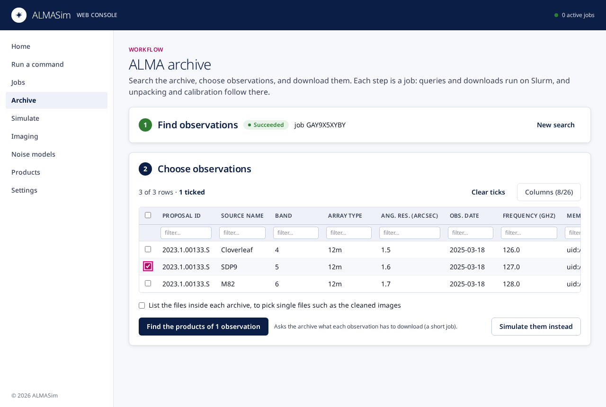
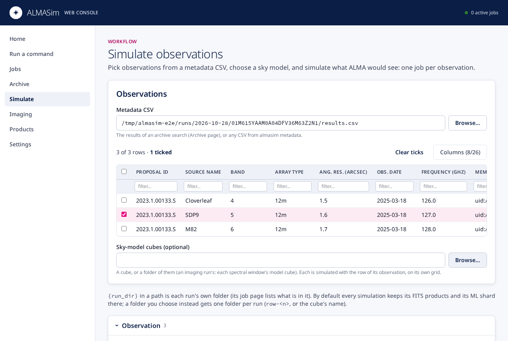
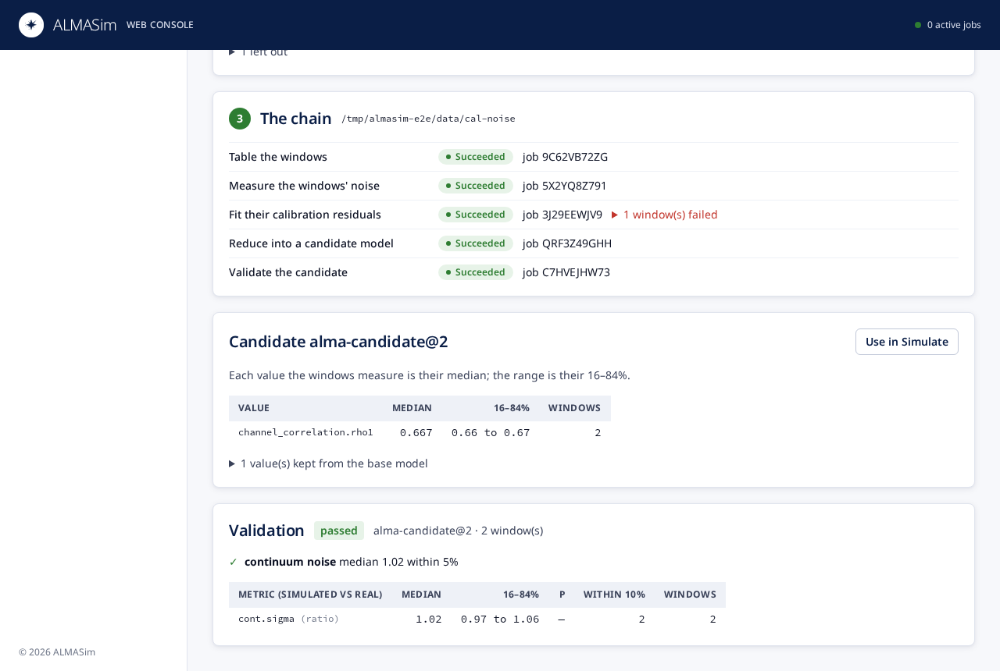

# Web console

`almasim serve` runs the web console for one user on a cluster's login
node: it serves the pages and API v2 on a private socket (or a port),
submits every command as a Slurm job (or, where the site profile says so,
runs it on its own machine), and follows the runs live. Each user starts
their own console; the runs live in run folders that a whole team can share.

## Getting started (on zwicky)

1. **Once:** use the shared install. Add to your `~/.bashrc` on the cluster:

   ```bash
   source /SKAO_data/cycle11/almasim/almasim.sh
   ```

   It puts `almasim` on your PATH and names the site profile. Check that
   everything a job needs is there (the checks run on a compute node):

   ```bash
   almasim doctor --slurm
   ```

2. **Start your console** on the login node, in a `tmux` or `screen` session
   so it outlives your SSH connection:

   ```bash
   almasim serve
   ```

   It prints an `ssh -L …` line and a link with your access token. Only you
   can open the console's socket, and only with that token.

3. **Open the tunnel** from your laptop with the printed line, e.g.

   ```bash
   ssh -N -L 8765:/home1/you/.almasim/serve.sock you@zwicky.login
   ```

   then open the printed link (`http://localhost:8765/?token=…`) in your
   browser. The token is kept as a cookie, so later visits need only
   `http://localhost:8765`. `almasim serve --status` shows the link again;
   `almasim serve --stop` stops the console (your jobs carry on).

4. **A first run:** *Run a command* → `doctor` → *Run*. It runs as a Slurm job;
   its page shows its log live, the batch script, and Slurm's accounting.
   *Archive*, *Imaging*, *Noise models* and *Simulate* lead through the
   usual work: search and download observations, image MeasurementSets,
   learn a noise model from them, simulate observations.

### With Open OnDemand

Where the site runs Open OnDemand, the console can also start from the
portal as an interactive app: a small Slurm job of yours on a compute node
(`almasim serve --managed`), opened with the session's *Connect* button,
with no tunnel. The app and its installation notes are in
[`ood/almasim`](https://github.com/astromadiv/ALMASim/tree/main/ood/almasim).

### Where results go

- Each run has a **run folder** under the runs root
  (`/SKAO_data/cycle11/almasim-runs/<day>/<run id>/`): its command line
  (`job.json`), batch script, logs and status. *Files* on its job page lists
  it; *Products* opens it.
- A command's own outputs go where its options say: the output folder you
  give *Imaging*, the destination and MeasurementSets folder you give
  *Archive*. *Simulate* keeps each
  simulation's FITS products in its run folder (`outputs/`) unless you choose
  another folder.
- The terminal sees the same runs: `almasim jobs list`, `almasim jobs logs -f
  <run>`, `almasim submit …`.

## The pages

Every page shows the live count of your active jobs in its header. Whatever a
page starts is an ordinary run: it has a job page, it is listed in *Jobs*,
and `almasim jobs` sees it too.

### Home

What is running now, your latest runs, how busy the cluster's partitions
are, and what the rest of your team ran lately (read only).


### Run a command

Every `almasim` command, as a form built from the command's own options:
the required inputs first, the rest folded by topic. Folders and files have
a *Browse…* picker. *Cluster* sets the Slurm resources (or, where the site
profile allows it, runs a short command on the console's own machine). The
form checks the command line as you type, and *Run* submits it.


### Jobs and a job's page

*Jobs* lists your runs, or the team's, by state, with a search over
commands, ids and paths. A job's page follows the run live: its log
(`stdout.log`, `stderr.log`), the parameters it ran with, the batch script,
the files in its run folder, and Slurm's accounting once it ends. From there
you can cancel it, run it again, edit and run it, or delete a finished run of
yours.

A running job with Dask workers on Slurm (imaging, the archive's unpacking
and calibration) gets a *Dask dashboard* button: it opens the dashboard of
the job's Dask scheduler (tasks, workers, memory) in a new tab. The console
relays it, so it works through the same SSH tunnel or portal as the console
itself; there is no port of its own to forward. The scheduler serves it on a
free port of its node and notes where in the run folder (`dashboard.json`);
the button appears once that note is there and goes when the run ends. Jobs
need bokeh in their Python for it (the `dashboard` extra, part of the shared
install; `almasim doctor` says when it is missing).


### Archive

Search the ALMA archive (with the filters of `almasim metadata`: project,
source, band, science keyword and more), tick observations, find their
products, and download them, raw or calibrated, to a folder you choose. Each step is a job. The
ticked rows can go straight to *Simulate* instead. Unpacked and calibrated
MeasurementSets go to their own folder (`raw_ms/` and `calibrated_ms/` in
it), by default `archive_ms/` in the destination. Each calibrated MS is also
linked into its member's `calibrated/` folder in the ALMA delivery tree under
the destination, which `ous_index.csv` indexes
([The delivery tree](downloads.md#the-delivery-tree)).



### Simulate

Pick observations from a metadata CSV (an archive search, or any
`almasim metadata` CSV), choose a sky model and the simulation options, and
start one job per observation. As you choose, the page estimates each
simulation's cube and the disk space its outputs take, and says what each
job will ask Slurm for.

*Noise* chooses the [noise model](noise_models.md): none (white thermal
noise only, the default), a released one (ALMASim's `alma` versions and the
team's own, from the shared install's `noise-models/` folder), or a model
file. For a released model it says what the model was measured on and lists
its components, one tick each: untick one to simulate without it (the page
writes `--noise-only` or `--noise-without`, whichever is shorter).

To simulate your own sky models, give a *Sky-model cubes* path beside the
metadata CSV: a cube, or a folder of them (an imaging run's gives each
window's `wsclean-cube-model.fits`). The page ticks the rows of the
observations the cubes show, lists each cube with its size, centre frequency,
channel width and pixel, and runs one simulation per cube of a ticked row on
the cube's own grid; see [external sky models](skymodels.md#external-sky-models).



### Imaging

Image calibrated MeasurementSets with WSClean: the console works out the
imaging parameters of each spectral window, images them all in one Slurm
driver with its own workers, follows the windows as they finish, and then
measures how well each was cleaned. The folder to image starts as the
`calibrated_ms/` of your last archive download that calibrated, and the
output folder is yours to choose. While the imaging runs, *Dask dashboard*
shows its workers at work.


### Noise models

Learn a noise model from real data. The page starts from your latest
imaging run and archive search: *List the windows* runs `almasim noise
windows`, which keeps the windows the imaging finished that are science
targets and links each to its archive row. Tick the windows to learn from,
choose the model to start from (`alma` by default) and an output folder,
and the page runs `noise extract`, `fit`, `aggregate` and `validate` as a
chain of jobs, each after the one before. A window that fails a step is
listed there and left out of the rest; a step fails only when all its
windows do. When the chain ends, the page shows the candidate's values (the
median over the windows and their 16–84% range, and the values it kept from
the base model) and the validation's verdict, metric by metric. *Use in
Simulate* opens *Simulate* with the candidate as the noise model. A
candidate whose validation passed can be released for the whole team:
give it a name of its own (`zwicky-alma`, never `alma`; an existing team
model's name makes the next version of it) and *Release…* runs `almasim
noise promote --site`, which writes it into the site's models folder with
who released it and when. *Simulate* then lists it (`zwicky-alma@1`) for
everyone. See [noise models](noise_models.md) for what each step measures.



### Products

Browse the data roots and run folders, open up to three images or cubes side
by side (the views pan and zoom together), read their FITS headers and the
cleaning quality. *map* integrates a cube into a 2D map, and the Wiener pair
reconstructs a simulated observation. Both run as jobs and open here when
done.


### Settings

Where runs go and what they ask Slurm for: the profile in effect, the site's
profile, and your own (TOML, edited here), which adds to the site's and wins
where both say something.

The screenshots come from the console the end-to-end tests drive
(`frontend/e2e/screenshots.spec.ts`), where every command is an instant
stand-in.

## A shared runs folder

A team sees each other's runs when the site profile names one runs root
for everyone:

```toml
# the site profile (ALMASIM_SITE_PROFILE), e.g. examples/site-profiles/zwicky.toml
runs_root = "/SKAO_data/cycle11/almasim-runs"
```

Every run is a folder `<runs root>/<day>/<run id>/` holding its manifest
(`job.json`), its status, its batch script and its logs. Each user's
console and `almasim jobs list --all` read every folder there:

- everyone **sees** every run: the Jobs page's *Team* view, and the team
  runs on the home page;
- only a run's **owner** (the user who submitted it) may cancel or delete
  it; the others get a refusal naming the owner (`almasim jobs cancel|delete`
  say the same). Anyone may start a copy of it as their own run (*Edit and
  run* on its page);
- deleting removes the run folder only (manifest, logs, and whatever the
  command wrote into it); outputs written elsewhere stay.

### Setting the folder up

The runs root has to be writable by the whole group, and stay so for the
day folders and run folders that users' consoles create in it:

```bash
# once, by whoever administers the shared area (here group "skao")
mkdir -p /SKAO_data/cycle11/almasim-runs
chgrp skao /SKAO_data/cycle11/almasim-runs
chmod 2775 /SKAO_data/cycle11/almasim-runs   # setgid: new folders inherit the group
```

- The **setgid bit** (`2` in `2775`) makes every folder created inside
  belong to the group, whoever creates it.
- Jobs run with **umask 002** (the job wrapper sets it), so what a run writes
  is group-writable too; nothing needs setting in users' shells for that.
- `almasim doctor` checks that the runs root is writable and group-shared
  ("writable, group-shared (setgid)").

A user who wants their runs private sets their own runs root in their user
profile (`~/.config/almasim/almasim.toml`, or the console's Settings page):

```toml
runs_root = "~/almasim-runs"
```

## For administrators: the shared install

One environment serves everyone: the Python every job runs (with almasim,
its web console, casatools, casatasks, python-casacore and bokeh (for the
Dask dashboard), at the versions
in `uv.lock`), a site profile pointing at it, and a file users source.

```bash
# on a compute node (it downloads Python and packages), from a checkout:
cd frontend && npm ci && npm run build && cd ..
scripts/install_shared.sh /SKAO_data/cycle11/almasim examples/site-profiles/zwicky.toml
```

It makes `env/` (the environment), `site.toml` (the template with that
environment's Python filled in), `almasim.sh` and `install.env` (the repo,
commit and template it was built from) under the prefix, all
group-writable. WSClean and the CASA data are not part of it: the site
profile names the shared ones (`[tools]`). When the template has a
`[tools] noise_models` line (zwicky's does), it also makes `noise-models/`,
setgid and group-writable, and points that line at it: the team's own
[noise models](noise_models.md#the-teams-own-models), which every user's
simulations can name and the console lists. An update leaves that folder
and its models as they are.

**Updating:** from the login node, with the install sourced:

```bash
source /SKAO_data/cycle11/almasim/almasim.sh
almasim update-shared                 # to main; or --ref <branch, tag or commit>
```

It refuses while runs under the site's runs root are not finished (a job
loads almasim from the environment while it runs, so files replaced under it
can break it; `--force` updates anyway). Then it submits one Slurm job that
clones the ref, builds the web app, runs that ref's `install_shared.sh` with
the recorded template, and ends with `almasim doctor`; it waits for the job
and prints the end of its log (`<prefix>/updates/<time>/update.log`). The job
uses the `git`, `npm` and `uv` on your PATH. An install made before
`install.env` existed needs `--repo` and `--template` once.

The environment is reinstalled in place and `site.toml` rewritten from the
template, so change the template (`examples/site-profiles/zwicky.toml`), not
`site.toml`. Running consoles keep the version they started with until their
users restart them (`almasim serve --stop`, then `almasim serve`).

By hand, the same is: from a checkout of the new version, on a compute
node, build the web app and run `install_shared.sh` again as above (or pass
a release's wheel as the third argument).
